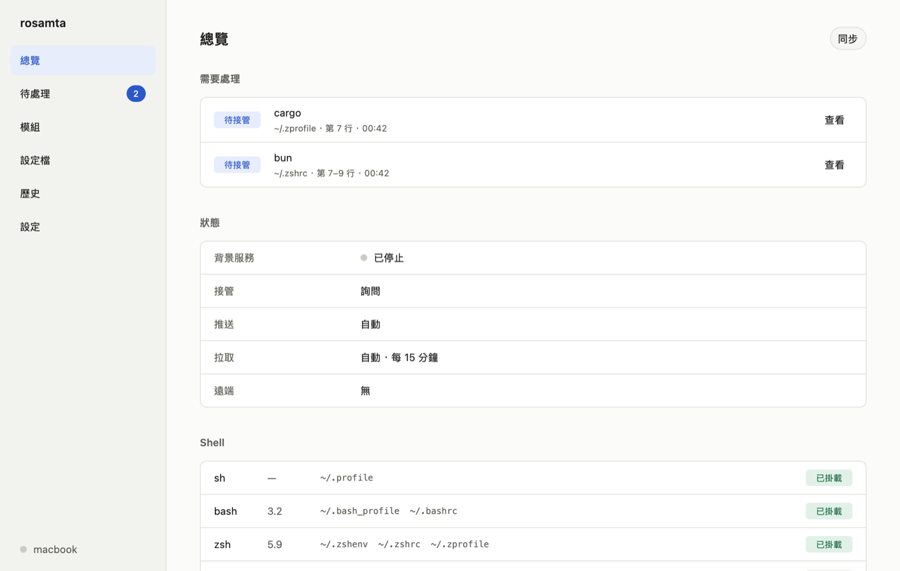
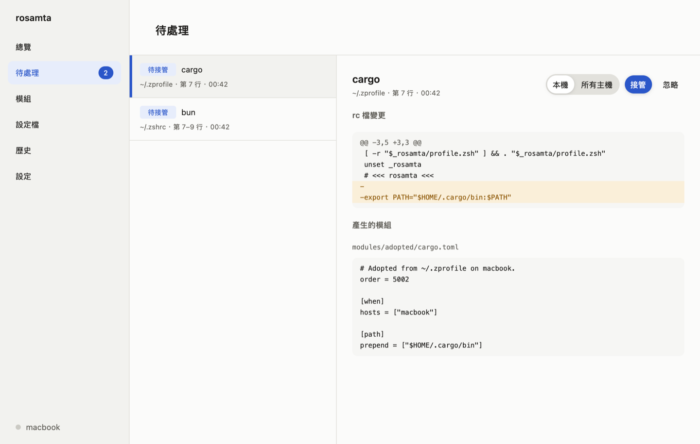
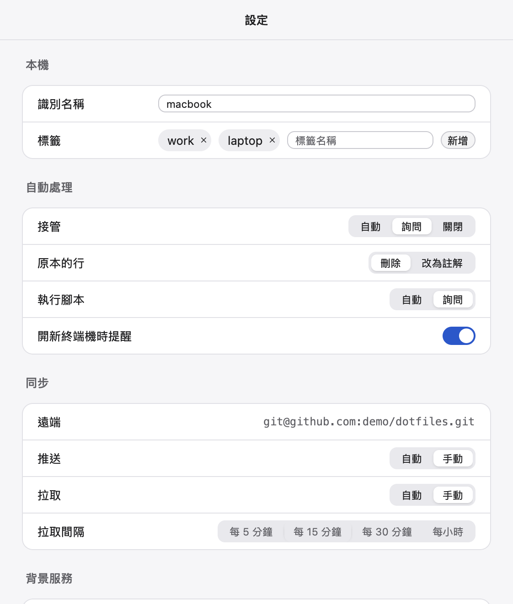
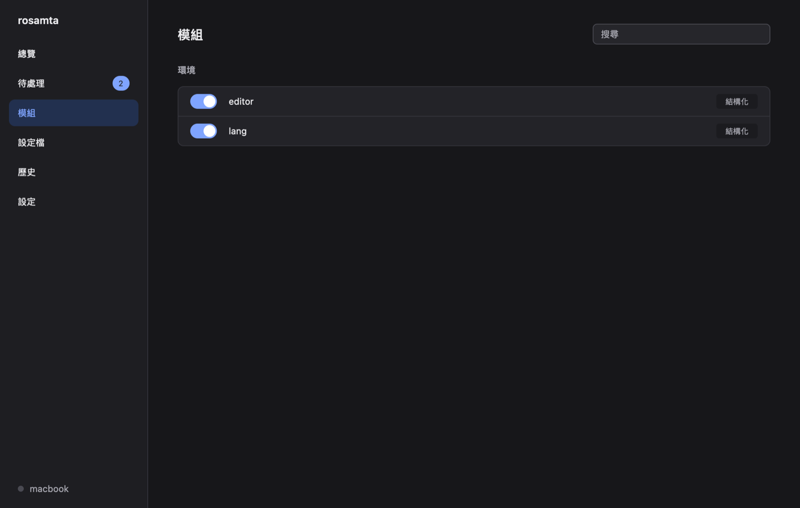
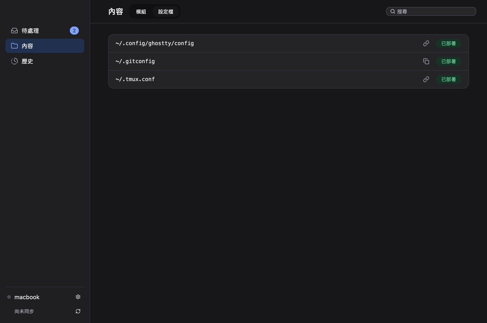
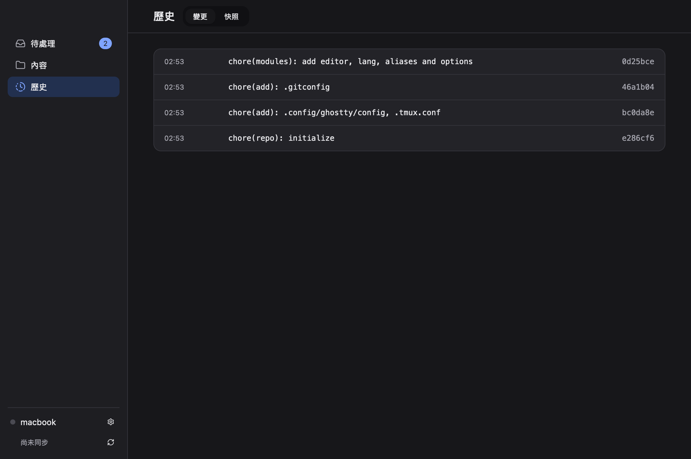

<div align="center">


<br>

[](LICENSE)
[](Cargo.toml)
[](#系統需求)
[](#系統需求)

</div>

## 總覽

rosamta 是跨 shell、跨主機的 dotfile 管理工具。設定宣告在 git repo 裡，render 成各 shell 載入的腳本；安裝程式之後寫進 shell 設定檔的內容，也可以接管回 repo。命令列程式有 `rosamta` 與 `rsmt` 兩個名稱，用法完全相同；另有桌面 App。目前仍在開發中。

### 🐚 **一份設定，四種 shell**
- module 以 TOML 宣告環境變數、PATH 與 alias，同一份套用到 sh、bash、zsh 與 fish
- 只適用於特定 shell 的程式碼放在 `[raw]`；可依主機、作業系統、架構或標籤限定套用範圍
- 套用前先以新的設定啟動每個 shell，出現新的錯誤就取消，shell 繼續使用原本的設定

### 📥 **接管 shell 設定檔**
- 把 `~/.zshrc` 等 shell 設定檔原有的內容搬進 repo，搬完後只剩 rosamta 的區塊
- 安裝程式之後寫入的內容列入待處理清單，可接管到這台主機或所有主機，也可以忽略
- 看起來像 API key 或 token 的內容不進 repo，只留在這台主機

### 🗂️ **設定檔部署**
- 以 symlink 或複製部署 `~/.config` 等設定檔，個別主機可以有自己的版本
- 敏感的設定檔加密後存進 repo，私鑰以密碼保護
- template 依主機產生不同內容，密碼與 token 在套用時從 Bitwarden 或自訂指令取得，不進 repo
- oh-my-zsh、zsh 插件、字型等外部內容鎖定版本下載，每台主機都一樣
- 新主機第一次套用就執行安裝腳本，之後只在腳本或 Brewfile 改變時再執行
- 目標位置已有不同內容時不覆蓋，顯示差異讓你決定
- 可從 chezmoi 匯入檔案、template、腳本與外部內容，轉不了的逐項列出

### 🔄 **多主機同步**
- 每次變更都是一個 commit，預設自動推送；背景服務定時拉取其他主機的變更
- 推送前檢查 API key 與 token，發現時停止推送
- 登入 GitHub 後可直接建立 private repo 作為遠端

### 🛰️ **背景服務**
- 登入後自動啟動：macOS 為登入項目，Linux 為 systemd 使用者服務
- 出現待處理的內容時發出通知，可以直接選擇接管、忽略或查看差異

### 🖥️ **桌面 App**
- 總覽、待處理項目的差異、module 開關、設定檔狀態、提交紀錄與快照、本機設定
- 跟隨系統的淺色與深色外觀

### ↩️ **隨時退出**
- 修改 shell 設定檔前先存快照，可還原單次接管，或全部還原成使用 rosamta 之前的內容
- `rsmt eject` 把目前的設定寫回 shell 設定檔，移除 rosamta 後 shell 的行為不變

## 示例圖

<details>
<summary><strong>展開查看 App 示例圖</strong></summary>

<br>

<div align="center">

| 總覽 | 待處理 | 設定 |
|:---:|:---:|:---:|
|  |  |  |

| 模組 | 設定檔 | 歷史 |
|:---:|:---:|:---:|
|  |  |  |

</div>

</details>

<br/>

## 安裝

正式版發布前，請從原始碼安裝：

```sh
cargo install --locked --git https://github.com/accidental-two-timer-sam-woof/rosamta-agent rosamta      # 命令列程式
cargo install --locked --git https://github.com/accidental-two-timer-sam-woof/rosamta-agent rosamta-gui  # 桌面 App
```

發布後可從 [Releases](https://github.com/accidental-two-timer-sam-woof/rosamta-agent/releases) 下載：

| 平台 | 檔案 |
|---|---|
| macOS | `.dmg`：桌面 App 與背景服務；命令列程式在 `rosamta.app/Contents/MacOS/rosamta` |
| Linux | `.deb`、`.rpm` 或 tarball：命令列程式、桌面 App 與背景服務 |

## 系統需求

| 項目 | 需求 |
|------|------|
| macOS | 13 以上，Apple 晶片或 Intel；背景服務需要 rosamta.app |
| Linux | x86_64 或 aarch64，發行的套件需要 glibc 2.28 以上；背景服務需要 systemd 使用者服務，否則自行執行 `rsmt daemon run` |
| shell | sh、bash 3.2、zsh 5.8、fish 3.6 以上 |
| git | 必要 |
| keychain（選用） | Linux 為 Secret Service；沒有時 GitHub token 存成只有你能讀取的檔案 |

## 使用方式

### 開始使用

建立新的 repo：

```sh
rsmt init
```

repo 建在 `~/.local/share/rosamta/repo`，本機設定寫在 `~/.config/rosamta/host.toml`，並從主機名稱產生這台主機的識別名稱。這一步不會修改任何 shell 設定檔。

在另一台主機加入同一個 repo（換成你的 repo 網址）：

```sh
rsmt init git@github.com:<你的帳號>/dotfiles.git
```

### 檢查設定

```sh
rsmt validate
```

檢查 repo 裡每個 TOML 檔，錯誤會附上檔案與行號，例如：

```text
/home/me/.local/share/rosamta/repo/modules/bun.toml:2:1: error: unknown field `phse`, expected one of `enabled`, `phase`, `order`, `when`
```

加上 `--json` 時，stdout 只輸出一個 JSON 文件，方便其他程式讀取：

```sh
rsmt validate --json
```

### 撰寫 module

每個 module 是 repo 中 `modules/` 底下的一個 TOML 檔，例如 `modules/editor.toml`：

```toml
[env]
EDITOR = "nvim"

[path]
prepend = ["~/.local/bin"]

[aliases]
ll = "ls -lh"
```

同一份宣告會套用到 sh、bash、zsh 與 fish。只適用於特定 shell 的程式碼放在 `[raw]`：

```toml
[raw]
zsh = '''
bindkey -e
'''
```

### 套用

```sh
rsmt apply --dry-run
rsmt apply
```

`--dry-run` 只顯示產生的腳本與 shell 設定檔會有的差異，不寫入任何檔案。

第一次套用時，每個已安裝 shell 的設定檔會加入一段以 `# >>> rosamta >>>` 開頭、`# <<< rosamta <<<` 結尾的區塊，區塊外的內容不會變動。修改設定檔之前，原本的內容會先存到 `~/.local/state/rosamta/snapshots`。

Debian 與 Ubuntu 預設的 `~/.bashrc` 開頭會讓非互動的 bash 直接結束，所以 `ssh 主機 指令` 執行的指令讀不到 rosamta 的環境變數。需要時，把 `~/.bashrc` 中的區塊移到這段之前；之後套用時會在原處更新。

套用前會先以新的設定啟動每個 shell；啟動時若出現新的錯誤，這次套用會取消並列出造成錯誤的 module，shell 繼續使用原本的設定。

### 接管設定檔的內容

```sh
rsmt adopt
```

把各 shell 設定檔中區塊以外的內容搬進 repo 的 `modules/adopted/`，搬完後設定檔只剩區塊。只有環境變數、PATH 與 alias 的段落會轉成套用到所有 shell 的 module；其他內容原樣保存，只套用到讀取該檔的 shell。看起來像 API key 或 token 的內容不會進 repo，而是存在 `~/.config/rosamta/local/modules/`。

修改前會先存 snapshot，每次接管都有一個 commit，輸出中的編號可用來還原：

```sh
rsmt restore <編號>
```

之後安裝程式或你自己加進設定檔的內容，會出現在待處理清單：

```sh
rsmt review
rsmt review accept <編號>
rsmt review ignore <編號>
```

`accept` 接管該項，預設只套用到這台主機，加上 `--scope all` 則套用到所有主機。`ignore` 讓內容留在設定檔，內容改變前不再列出。清單不是空的時候，開啟互動 shell 會顯示一行提醒。

接管方式寫在 `~/.config/rosamta/host.toml`：

| 設定 | 可用的值 |
|---|---|
| `adopt` | `ask`：列入待處理（預設）；`auto`：直接接管；`off`：不處理 |
| `adopt_original` | `delete`：刪除原內容（預設）；`comment`：改成註解 |
| `shell_notice` | `true`：開 shell 時提醒（預設）；`false` |

### 管理設定檔

```sh
rsmt add ~/.config/nvim ~/.gitconfig
```

把檔案或目錄移進 repo 的 `home/`，在 `dotfiles.toml` 加上宣告，再以 symlink 放回原位，並建立一個 commit。之後在其他主機執行 `rsmt apply` 也會部署這些設定檔。內容看起來像 API key 或 token 時，`rsmt add` 會拒絕，請改用 `--encrypt`。shell 的啟動檔（例如 `~/.zshrc`）不能加入，shell 的設定放在 module。

每個設定檔在 `dotfiles.toml` 有一筆宣告，例如：

```toml
[[dotfile]]
path = ".config/nvim"

[[dotfile]]
path = ".ssh/config"
deploy = "copy"
permissions = "0600"
encrypted = true

[[dotfile]]
path = ".gitconfig"
source = "hosts/mbp/.gitconfig"
when = { hosts = ["mbp"] }
```

| 欄位 | 說明 |
|---|---|
| `path` | 相對於家目錄的位置 |
| `source` | repo 中的內容，預設為 `home/<path>` |
| `deploy` | `link`：symlink 回 repo（預設）；`copy`：複製；`template`：依主機產生內容；`create`：不存在時才建立 |
| `permissions` | 部署後設定的權限，例如 `"0600"` |
| `encrypted` | 加密後存在 repo 中，不能搭配 `deploy = "link"` |
| `when` | 套用範圍，寫法與 module 相同 |

同一個路徑有多筆宣告符合本機時，`when.hosts` 只列本機的那一筆最優先，其次是列出本機的那一筆。

- `link`：app 修改設定檔就是修改 repo。編輯器以新檔案取代 symlink 時，內容會寫回 repo，並重新建立 symlink。
- `copy`：repo 改變時更新。本機的檔案被修改時依接管偏好處理：`auto` 寫回 repo，`ask` 列入待處理清單，`off` 不處理，之後也不覆蓋。
- `create`：目標不存在時才從 repo 複製，之後不再管理，適合給 app 自行修改的初始設定。

部署時，目標位置已有內容不同的檔案不會被覆蓋。在終端機執行 `rsmt apply` 時，會顯示差異並詢問要採用 repo 的版本、保留這台主機的版本，或稍後處理。稍後處理的衝突，以及非互動執行與背景服務遇到的衝突，都會列在待處理清單：

```sh
rsmt review accept <編號>
rsmt review discard <編號>
rsmt review ignore <編號>
```

`accept` 保留這台主機的版本，存在 repo 的 `hosts/<識別名稱>/` 並只用於這台主機；加上 `--scope all` 則用於所有主機。`discard` 採用 repo 的版本，原本的內容保存在 snapshot。`ignore` 讓兩邊維持原狀，直到其中一邊改變。

不再管理某個設定檔：

```sh
rsmt forget ~/.config/nvim
```

宣告與 repo 中的內容會被移除，設定檔以一般檔案留在原位；其他主機下次套用時也一樣。

#### 加密

```sh
rsmt add --encrypt ~/.ssh/config
```

第一次加密時要設定密碼。加密用的私鑰以這個密碼加密後存成 repo 的 `key.age`，這台主機的副本存在 `~/.config/rosamta/age.key`。新主機第一次在終端機執行 `rsmt apply` 時輸入一次密碼即可；背景服務不會詢問密碼，會先略過加密的設定檔。密碼遺失後無法找回，只有已經解開私鑰的主機還能讀取加密的設定檔。

#### Template

```sh
rsmt add --template ~/.gitconfig
```

`deploy = "template"` 的設定檔以 [minijinja](https://github.com/mitsuhiko/minijinja)（Jinja 語法）產生內容，`rsmt add --template` 會原樣加入，之後在 repo 中改寫依主機不同的部分：

```jinja
[user]
	name = {{ vars.name }}
	email = me@work.exampleme@example.com
	signingkey = {{ bitwarden("GPG key", "notes") }}
```

| 名稱 | 內容 |
|---|---|
| `host.id`、`host.tags` | 本機的識別名稱與標籤 |
| `host.os`、`host.arch` | 例如 `macos`、`aarch64` |
| `host.home` | 家目錄 |
| `vars.<名稱>` | `host.toml` 的 `[vars]`，只存在這台主機 |
| `bitwarden(項目, 欄位)` | Bitwarden 項目的欄位，省略時為密碼；另有 `username`、`notes`、`totp`（TOTP 金鑰，不是驗證碼）與自訂欄位 |
| `secret(名稱, 參數)` | 執行 `secrets.toml` 宣告的指令，取它的輸出 |
| `bitwarden_ssh_socket()` | Bitwarden SSH agent 的 socket 路徑，沒有安裝時為空字串 |

template 不能讀取其他檔案或執行其他程式。缺少 `vars` 時，在終端機執行 `rsmt apply` 會逐一詢問並寫進 `host.toml`：

```toml
[vars]
name = "Tsai"

[secrets]
bitwarden = ["rbw", "bw"]
```

`bitwarden()` 依序使用已登入的 [rbw](https://github.com/doy/rbw)、[bw](https://bitwarden.com/help/cli/) 與 [bws](https://bitwarden.com/help/secrets-manager-cli/)（Secrets Manager，以 key 名稱查詢），`[secrets] bitwarden` 可以改變順序。bws 的 access token 存在系統鑰匙圈：

```sh
rsmt secrets bws login
```

其他密碼管理工具在 repo 的 `secrets.toml` 宣告，`{arg}` 換成 `secret()` 的第二個參數：

```toml
[commands.op]
run = ["op", "read", "{arg}"]
```

只有在終端機執行的 `rsmt apply` 會解鎖密碼管理工具或執行 `secrets.toml` 的指令，每次套用每個值只取一次。背景服務、App 與非互動執行遇到鎖住的工具、需要執行指令或缺少 `vars` 時，保留原本的內容，並在待處理清單列出在等待什麼；在終端機執行 `rsmt apply` 後就會消失。

產生的檔案沒有宣告權限時為 `0600`。本機修改了產生的內容時會列在待處理清單：`accept` 把它存成這台主機專用的 `copy`，`discard` 重新產生。用到 `bitwarden()` 或 `secret()` 的 template 沒有加密時不能 `accept`，請改寫 repo 中的 template。

### 外部內容

oh-my-zsh、zsh 與 tmux 的插件、字型等從外部下載的內容宣告在 repo 的 `externals.toml`：

```toml
[[external]]
path = ".oh-my-zsh"
git = "https://github.com/ohmyzsh/ohmyzsh.git"

[[external]]
path = ".oh-my-zsh/custom/plugins/zsh-autosuggestions"
git = "https://github.com/zsh-users/zsh-autosuggestions.git"

[[external]]
path = ".local/share/fonts/JetBrainsMono"
archive = "https://github.com/ryanoasis/nerd-fonts/releases/download/v3.4.0/JetBrainsMono.zip"
when = { os = ["linux"] }
```

| 欄位 | 說明 |
|---|---|
| `path` | 下載到的位置，相對於家目錄 |
| `git` | git repo 的網址，以 `rev` 鎖定 commit |
| `branch` | `rsmt externals update` 追蹤的分支，預設為遠端的預設分支 |
| `archive` | `.tar.gz`、`.tar` 或 `.zip` 壓縮檔的網址，以 `sha256` 鎖定內容 |
| `strip` | 解壓時去掉開頭幾層目錄 |
| `when` | 套用範圍，寫法與 module 相同 |

```sh
rsmt externals update               # 全部更新到最新版本
rsmt externals update ~/.oh-my-zsh  # 只更新這一個
```

`rsmt externals update` 把 `rev` 與 `sha256` 寫進 `externals.toml` 並 commit，再下載到這台主機；其他主機拉取後下載同一個版本。新增的宣告要先執行一次才會鎖定。

- 套用時先下載外部內容，再檢查 shell，所以載入 oh-my-zsh 的 module 在新主機上也能通過檢查。
- git 的內容是停在鎖定 commit 的工作目錄。有未 commit 的修改時不更新；oh-my-zsh 等工具自己更新後，套用會回到鎖定的版本，建議關閉工具的自動更新，改用 `rsmt externals update`。
- 壓縮檔的內容被修改後不再更新。
- 目標位置已有其他內容時不覆蓋；已有同一個 repo 的 clone 時直接沿用。
- 只有 `git` 外部內容的裡面可以再放外部內容或設定檔，例如 oh-my-zsh 的插件。
- 從 `externals.toml` 移除的內容留在原地，不再管理。
- `rsmt apply`、拉取與背景服務都會下載與更新外部內容。沒有更新的內容（本機已修改、已有其他內容）每次 `rsmt apply` 都會列出；背景服務遇到的問題寫在 `daemon.log`。

### 腳本

需要在主機上執行的設定腳本宣告在 repo 的 `scripts.toml`：

```toml
[[script]]
source = "scripts/install-tools.sh"
run = "once"
timing = "before"

[[script]]
source = "scripts/brew-bundle.sh"
run = "onchange"
watch = ["Brewfile"]
when = { os = ["macos"] }
```

| 欄位 | 說明 |
|---|---|
| `source` | 腳本在 repo 中的位置，也是腳本的名稱 |
| `run` | `once`：每台主機成功執行一次；`onchange`：腳本或 `watch` 的內容改變時再執行 |
| `timing` | `before`：在 shell 與設定檔之前執行；`after`（預設）：在設定檔部署之後 |
| `watch` | `onchange` 一併比對的 repo 路徑，可以是目錄 |
| `when` | 套用範圍，寫法與 module 相同 |

- 腳本以第一行 shebang 的直譯器執行，沒有 shebang 時用 `sh`，不需要執行權限。工作目錄是家目錄，環境變數另有 `ROSAMTA_REPO` 與 `ROSAMTA_HOST_ID`。
- 失敗（結束碼不為 0）的腳本會再執行：在終端機執行 `rsmt apply` 時直接執行，其他情況列在待處理清單。一個腳本失敗不影響其他腳本與設定檔。
- 在終端機執行 `rsmt apply` 時，腳本直接執行並可以詢問輸入或 `sudo`。
- 其他情況（背景服務、App、拉取、沒有終端機的 `rsmt apply`）依 `host.toml` 的 `scripts`：`ask`（預設）列在待處理清單並通知，`auto` 直接執行，失敗時列在待處理清單。
- 待處理清單中的腳本：`accept` 執行列出時的版本，`ignore` 當作已執行。
- 每次執行的輸出寫在 `$XDG_STATE_HOME/rosamta/scripts/<source>.log`，只有自己可讀，超過 1 MiB 的部分不記錄。
- 沒有終端機時，腳本最多執行 30 分鐘，超過時連同它啟動的程式一起結束。
- 腳本在背景啟動、要持續執行的程式，輸出要導到別處，例如 `cmd > /dev/null 2>&1 &`；否則 rosamta 結束後，它一寫出輸出就會被終止。

### 從 chezmoi 匯入

```sh
rsmt import chezmoi --dry-run   # 只列出結果
rsmt import chezmoi             # 匯入並建立一個 commit
```

- 讀取參數指定的 source 目錄，否則 `chezmoi source-path` 的位置，否則 `~/.local/share/chezmoi`，並遵循 `.chezmoiroot`。需要先執行 `rsmt init`。
- 不修改 chezmoi 的 source 與設定，不部署，也不連網路；匯入後以 `rsmt apply --dry-run` 確認。
- 檔案依 chezmoi 的 `mode` 以複製（預設）或 symlink 部署，權限與 chezmoi 套用的結果相同；`.chezmoiignore` 排除的不匯入。
- template 轉成 rosamta 的 template，支援作業系統、架構與 hostname 的條件、資料、Bitwarden 與 1Password；整份只適用於某些平台的檔案改為 `when`。chezmoi 設定檔 `[data]` 的值寫入這台主機 `host.toml` 的 `[vars]`，這台主機的 hostname 換成主機識別名稱。安裝了 chezmoi 時，產生的內容與 chezmoi 不同的 template 不匯入。
- 加密的檔案以 chezmoi 解密，再以 rosamta 的金鑰加密；repo 還沒有金鑰時在終端機設定密碼。
- 腳本改為 `onchange` 並記為這台主機已執行過，`include … | sha256sum` 改為 `watch`。
- `git-repo` 與 `archive` 類型的外部內容寫入 `externals.toml`，git repo 鎖定在目前 clone 的版本。
- 轉不了的項目（`modify_`、`symlink_`、`exact_` 目錄、不支援的 template 寫法等）不宣告，原檔複製到 repo 的 `chezmoi-import/`。shell 設定檔不匯入，內容由接管處理。
- source 中的 symlink 不讀取，git 忽略的路徑（例如全域 excludes 中的 `.env`）不匯入。repo 有尚未推送的變更時不匯入；匯入失敗時 repo 回到匯入前的內容。
- 每個項目的結果與原因列在輸出與 commit 內容中，`--json` 以原因代碼輸出。

### 同步到其他主機

```sh
rsmt sync
```

先拉取其他主機推送的變更並套用，再把這台主機的變更推送到遠端。也可以分開執行：

```sh
rsmt pull
rsmt publish
```

`rsmt publish` 會先把你在 repo 中手動修改的內容建立成 commit。commit 依你的 git 設定簽章。

`rsmt init` 建立的 repo 沒有遠端，要先加上一個（換成你的 repo 網址）：

```sh
git -C ~/.local/share/rosamta/repo remote add origin git@github.com:<你的帳號>/dotfiles.git
rsmt publish
```

接管、還原，以及 `rsmt add`、`rsmt forget`、`rsmt review accept` 建立 commit 後會立即推送。在 `~/.config/rosamta/host.toml` 設定 `publish = "manual"` 時，只在執行 `rsmt publish` 或 `rsmt sync` 時推送。

拉取時，這台主機還沒推送的 commit 會接在遠端的變更之後。兩台主機改到同一個檔案的同一處時，拉取會中止並列出這些檔案，repo 維持拉取前的狀態；在 repo 中用 git 合併後，再執行 `rsmt sync`。拉取到的 module 讓 shell 啟動時出現新的錯誤時，repo 保留新內容，shell 繼續使用原本的設定。

#### 推送受阻

推送前會檢查要推送的內容。看起來像 API key 或 token 時，推送會停止並列出檔案、行號與符合的規則，手動修改的內容也不會被 commit；把該內容移出 repo 後再推送一次。內容如果已經在 commit 中，要先修改那個 commit。

| 情況 | 結果 |
|---|---|
| commit 無法簽章，例如背景中無法輸入 GPG 密碼 | 不建立 commit，變更留在 repo 中；解鎖金鑰後再執行 `rsmt publish` |
| 遠端拒絕存取 | 不推送；確認 SSH 金鑰或 GitHub 登入後再推送 |
| 連不上遠端 | commit 留在本機，下一次 `rsmt sync` 時推送 |

### 連結 GitHub

```sh
rsmt remote github login
```

依畫面上的網址開啟 GitHub 的驗證頁，輸入顯示的驗證碼並授權。token 存在系統的 keychain（macOS Keychain、Linux Secret Service）；沒有 keychain 時存在 `~/.config/rosamta/github-token`，只有你能讀取。

登入後，建立一個 private repo 作為遠端：

```sh
rsmt init --github dotfiles
```

或加入既有的 repo：

```sh
rsmt init --github <帳號>/dotfiles
```

SSH 金鑰能通過 GitHub 驗證時使用 SSH；否則以登入的 token 走 HTTPS，相關設定只寫在 repo 中，不修改 `~/.gitconfig`。

登出時會刪除 token：

```sh
rsmt remote github logout
```

### 背景服務

```sh
rsmt daemon enable
```

背景服務登入後自動啟動。rc 檔出現新內容時，依接管偏好接管或加入待處理清單；部署的設定檔被修改時，依上面「管理設定檔」的規則處理；repo 有變動時立即套用；並依拉取偏好定時同步。

- macOS：背景服務是 rosamta.app 中的登入項目。系統要求核准時，到「系統設定 › 一般 › 登入項目」允許 rosamta。出現待處理的內容時會發出通知，可以直接選「接管」、「忽略」或「查看差異」。
- Linux：註冊為 systemd 使用者服務 `rosamta.service`。沒有 systemd 使用者服務的環境（例如容器），請在登入後的 session 中自行執行：

```sh
rsmt daemon run
```

查看狀態與停用：

```sh
rsmt daemon status
rsmt daemon disable
```

背景服務啟動時會讀取一次 login shell 的環境變數，例如 `SSH_AUTH_SOCK`；修改後先停用再啟用，才會生效。沒有通知服務時不發通知，只更新待處理清單並在開 shell 時提醒。執行紀錄寫在 `~/.local/state/rosamta/daemon.log`。

`~/.config/rosamta/host.toml` 中與背景服務有關的設定：

| 設定 | 可用的值 |
|---|---|
| `pull` | `auto`：定時同步，電腦從睡眠喚醒後也會同步一次（預設）；`manual`：只在執行 `rsmt sync` 或 `rsmt pull` 時拉取 |
| `pull_interval` | 定時同步的間隔，單位為分鐘（預設 15，至少 1） |

### 移除 hook

```sh
rsmt unhook zsh
```

只移除該 shell 的區塊，之後的 `rsmt apply` 也不會再加回去。要重新加入：

```sh
rsmt hook zsh
```

### 停止使用

```sh
rsmt eject
```

把目前生效的設定直接寫進各 shell 的設定檔並移除區塊，以 symlink 部署的設定檔換成內容相同的一般檔案，也停用背景服務；之後即使移除 rosamta，shell 的 PATH、環境變數與 alias 都不變。

```sh
rsmt restore --original
```

把 rosamta 改過的每個設定檔還原成第一次修改前的內容，刪除 rosamta 建立的設定檔，也停用背景服務。

兩個指令都會先顯示差異並要求確認；不在終端機中執行時，要加上 `--yes`。

### 編輯器支援

`rsmt schema` 輸出各種檔案的 JSON Schema，種類有 `repo`（`rosamta.toml`）、`module`、`host`（`host.toml`）、`dotfiles`（`dotfiles.toml`）、`externals`（`externals.toml`）、`scripts`（`scripts.toml`）與 `secrets`（`secrets.toml`）：

```sh
rsmt schema module > module.schema.json
```

在 TOML 檔第一行加上 `#:schema ./module.schema.json`，Taplo 或 Tombi 等編輯器外掛就能提示欄位並即時檢查。

### 檔案位置

所有平台都使用 XDG 路徑；對應的環境變數未設定或不是絕對路徑時，使用括號中的預設值。

| 內容 | 位置 |
|---|---|
| 本機設定 | `$XDG_CONFIG_HOME/rosamta/host.toml`（`~/.config`） |
| repo | `$XDG_DATA_HOME/rosamta/repo`（`~/.local/share`） |
| 產生的腳本 | `$XDG_DATA_HOME/rosamta/generated`（`~/.local/share`） |
| 狀態 | `$XDG_STATE_HOME/rosamta`（`~/.local/state`） |

### 結束碼

| 結束碼 | 意義 |
|---|---|
| 0 | 成功 |
| 2 | 指令用法或設定有誤 |
| 1 | 其他錯誤，例如無法讀取檔案 |

<br/><br/>

---

<br/><br/>

## 開發環境建置
[](https://www.rust-lang.org)

### 需求
- rustup：Rust 版本由 `rust-toolchain.toml` 決定，第一次執行 `cargo` 時自動下載
- macOS：Xcode 與 Metal 編譯器
- Linux：桌面 App 需要的系統套件見 [CONTRIBUTING.md](CONTRIBUTING.md)
- 建置或測試整個 workspace 都會建置桌面 App
- Docker 或 OrbStack：發行版測試需要

### 建置與執行
```bash
git clone https://github.com/accidental-two-timer-sam-woof/rosamta-agent.git
cd rosamta-agent

# 命令列程式
cargo run -p rosamta --bin rsmt -- --help

# 桌面 App
cargo run -p rosamta-gui

# 測試
cargo test --workspace --locked
```

> 💡 送 PR 前的完整檢查、發行版測試與安裝程式 fixture 的擷取方式，見 [CONTRIBUTING.md](CONTRIBUTING.md)。

## 專案架構

```
rosamta-agent/
├── crates/
│   ├── rosamta-core/             # 核心邏輯，命令列程式、App 與背景服務共用
│   │   ├── locales/              # 背景服務與 App 的文字（繁體中文、英文）
│   │   └── src/
│   │       ├── adopt/            # 接管 shell 設定檔、待處理清單、秘密偵測
│   │       ├── daemon/           # 背景服務、login shell 環境、通知
│   │       ├── dotfiles/         # 設定檔部署、加密、衝突處理
│   │       ├── github/           # GitHub 登入與 token 保存
│   │       ├── sync/             # 拉取、推送與推送前檢查
│   │       ├── render.rs         # 把 module render 成各 shell 的腳本
│   │       ├── apply.rs          # 套用與 shell 啟動檢查
│   │       ├── hooks.rs          # shell 設定檔中的 rosamta 區塊
│   │       ├── snapshot.rs       # 修改前的快照與還原
│   │       └── validate.rs       # 檢查 repo 中的 TOML 檔
│   ├── rosamta/                  # 命令列程式（rosamta / rsmt）
│   └── rosamta-gui/              # 桌面 App（GPUI）
│       └── src/pages/            # 總覽、待處理、模組、設定檔、歷史、設定
├── assets/                       # App 圖示
├── packaging/                    # macOS App bundle、Homebrew、AUR
├── tests/
│   ├── docker/                   # 各發行版的 shell 測試映像
│   └── fixtures/installers/      # 安裝程式寫入 shell 設定檔前後的內容
├── docs/adr/                     # 架構決策紀錄
├── openspec/                     # 功能規格與變更提案
├── GLOSSARY.md                   # 用語定義
└── .github/workflows/            # CI 與發行
```

## 貢獻
歡迎 PR 與 Issue！

送出前請確認：
1. 依 [CONTRIBUTING.md](CONTRIBUTING.md) 在本機跑過格式、clippy、測試與 `cargo deny`
2. 用語以 [GLOSSARY.md](GLOSSARY.md) 為準，設計不違反 [docs/adr](docs/adr) 的決策
3. 影響架構或規模較大的變更，先在 `openspec/changes/` 以 [OpenSpec](https://github.com/Fission-AI/OpenSpec) 規劃
4. commit message 使用英文的 Conventional Commits

## 授權
[Apache-2.0](LICENSE)。第三方套件的授權見 [THIRD_PARTY_NOTICES.md](THIRD_PARTY_NOTICES.md)。
